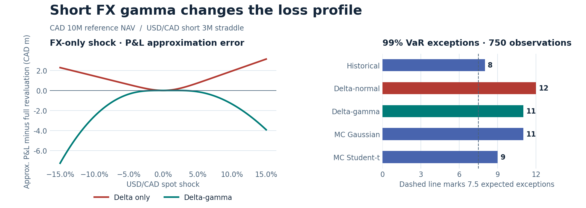

# CAD multi-asset VaR / ES engine

[Open the interactive case study](https://y68wu.github.io/var-es-engine/) · [Read the four-week project handbook](https://y68wu.github.io/var-es-engine/handbook.html)

**Delta-normal put 99% one-day VaR at CAD 125.7k, 4.3% below Gaussian full revaluation (CAD 131.2k).** On identical Gaussian paths, linear P&L gave CAD 127.9k versus CAD 131.2k with full revaluation. In the control book without options, linear P&L slightly overstated VaR. The snapshot uses the October 21, 2026 close.

Across 750 out-of-sample observations, delta-normal produced 12 exceptions, historical simulation 8 and Student-t Monte Carlo 9. All models were green in the final 250 observations, while the Christoffersen independence test flagged exception clustering over the full period.



## Reproduce

Requires Python 3.10 or newer and internet access for the data download. The committed charts and summary tables can be read directly on GitHub.

```bash
python -m venv .venv
source .venv/bin/activate
python -m pip install -e '.[dev,notebook]'
python -m var_es.market --start 2007-01-01 --end 2026-10-21 --output data/market.csv
cad-var-es
pytest -q
```

Open [the analysis notebook](notebooks/01_case_study.ipynb) with `jupyter lab`. The CLI writes the day-by-day risk forecasts, exception flags, approximation grid and portfolio marks to `reports/local/`. [Data provenance and download conventions](data/README.md) describe the series, date alignment and volatility calculation. Downloaded market observations stay in the local cache.

## Portfolio and pricing

| Position | Sizing at reference inception | Valuation |
|---|---:|---|
| XIU | CAD 5M | Equity close on an adjusted-price basis |
| 5Y Government of Canada bond | CAD 3M market value | Semiannual cash flows discounted on the BoC zero curve |
| 10Y Government of Canada bond | CAD 2M market value | Same method, with a separate 10Y key rate |
| Short 3M USD/CAD straddle | USD 15M **per leg** | Short one ATM call and one ATM put, Garman–Kohlhagen |
| Cash | Initial straddle premium | CAD cash held flat in shock revaluations |

The reference book starts with CAD 10M NAV. The straddle has USD 30M gross underlying notional and is intentionally large enough to make short gamma visible. FX spot is CAD per USD. The bond positions are hypothetical fixed-coupon instruments. [Position sensitivities](reports/sensitivities.csv) list option delta, gamma, vega and theta, plus parallel and key-rate bond DV01 and convexity. The test suite checks the analytical sensitivities against finite differences. See the [Garman–Kohlhagen paper](https://doi.org/10.1016/S0261-5606(83)80001-1).

The latest-day snapshot and the rolling backtest are separate reference books. The backtest fixes equity units, bond face values and option notional at the first forecast date. Each forecast sets a fresh 3M ATM strike, then holds strike and tenor fixed while shocking markets. The five modeled shocks are XIU and USD/CAD log returns, changes in the 5Y and 10Y zero yields, and the change in annualized FX EWMA volatility. Rates and volatility are decimal units. The rolling forecast and realized hypothetical P&L use the same five-factor revaluation convention. The daily mark file also prices each date's fresh straddle and separately records the one-day change for the prior day's option vintage, with time elapsed and actual curve and carry-proxy moves.

## Risk models and validation

All estimates are CAD losses for one trading day. VaR uses 99% and ES uses 97.5% confidence. Each forecast uses the preceding 500 aligned daily observations. The 750 realization dates are strictly outside their respective estimation windows.

| Model | Loss distribution |
|---|---|
| Historical simulation | Full revaluation for each of the 500 observed joint shocks |
| Delta-normal | Linear P&L from the sample mean and covariance |
| Delta-gamma | Quadratic P&L with Cornish–Fisher adjustment for skewness and kurtosis |
| Monte Carlo | Full revaluation of 10,000 correlated shocks per distribution, comparing Gaussian and Student-t with six degrees of freedom |

Monte Carlo uses a Cholesky factor of the estimated covariance and common random numbers across dates. Student-t draws are scaled to match the Gaussian covariance. The FX shock plot uses the same book with only FX spot moving. A positive error means the approximation shows a higher P&L than full revaluation.

| Model | 99% VaR (CAD k) | 97.5% ES (CAD k) | Exceptions / 750 |
|---|---:|---:|---:|
| Historical simulation | 202.1 | 211.7 | 8 |
| Delta-normal | 125.7 | 126.3 | 12 |
| Delta-gamma | 131.2 | 131.9 | 11 |
| MC Gaussian | 131.2 | 133.5 | 11 |
| MC Student-t | 150.0 | 155.2 | 9 |

The backtest covers October 11, 2023 through October 21, 2026. At the report date, the [paired Gaussian comparison](reports/comparison.csv) gives a 2.6% linear VaR shortfall with the straddle. It uses identical innovations for linear and full repricing. With USD/CAD up 2% and all other factors fixed, delta alone shows a CAD 69.7k gain, delta-gamma shows a CAD 72.0k loss, and full revaluation shows a CAD 73.7k loss. At larger spot shocks the local quadratic can substantially overstate the loss.

[Coverage diagnostics](reports/diagnostics.csv) include the Kupiec unconditional coverage test, Christoffersen independence and conditional coverage tests, and the Basel traffic-light thresholds on the **last 250** observations. Green is 0–4 exceptions, amber is 5–9, and red is 10 or more. The dashed line in the figure marks 7.5 expected exceptions across 750 days. See [Kupiec](https://fedinprint.org/item/fedgfe/34596/original), [Christoffersen](https://users.ssc.wisc.edu/~bhansen/718/Christoffersen1998.pdf) and [Basel MAR32](https://www.bis.org/basel_framework/chapter/MAR/32.htm?inforce=20230101&published=20200327&tldate=20191218).

## Stress tests

[Stress results](reports/stress.csv) show total and position-level P&L. Historical replays apply the daily moves since the preceding close of each episode to the same report-date book. Spot moves are relative and yield, carry-rate and volatility moves are absolute. We report the worst observed close and the period-end change for September–November 2008, March 2020 and calendar 2022. Strike and maturity stay fixed throughout each replay, so these paths describe scenario exposure for today's holdings.

Hypotheticals shift the CAD zero curve and CAD option discount proxy up 200 bp, depreciate the CAD by 10% in USD terms (an 11.11% increase in USD/CAD), double FX volatility, and combine all three moves.

| Scenario | Portfolio loss (CAD M) |
|---|---:|
| September–November 2008, worst close | 6.16 |
| March 2020, worst close | 2.76 |
| 2022 rate hikes, worst close | 2.46 |
| Combined hypothetical | 2.51 |

## Independent data checks

The [market context report](reports/context.json) cross-checks Yahoo's USD/CAD closes against the Bank of Canada's independent daily average. Across 2,432 matched sessions, the median absolute spot gap was 18 bp, but the same-date log return correlation was only 0.37. The report shows how that correlation changes when the series are aligned one joint session apart. Provider timestamps matter when building a daily risk panel.

Using the most recent prior VIX close and an illustrative threshold of 20, realized loss exceeded delta-normal VaR on 6 of 623 days below the threshold (0.96%) and 6 of 127 days at or above it (4.72%). This descriptive split uses the original forecasts and different sample sizes. See the [BoC exchange rate series](https://www.bankofcanada.ca/rates/exchange/daily-exchange-rates/) and [Cboe VIX via FRED](https://fred.stlouisfed.org/series/VIXCLS).

## Website

GitHub Pages serves the static files in `docs/`. The case study uses the committed summary tables and a precomputed grid of exact portfolio valuations for its FX shock lab. The four-week handbook maps 28 illustrative calendar dates to decisions, implementation steps and checks in the repository.

After running the analysis above, regenerate the supplementary report and the site's data file.

```bash
python -m var_es.context
python -m var_es.site
python -m http.server 8000 --directory docs
```

## Limitations

- EWMA realized FX volatility (λ = 0.94) proxies for implied volatility. The option pricer uses a flat volatility and flat CAD and USD carry proxies from CORRA and 3M Treasury yields. No option quotes, volatility smile, FX basis or bid–ask spreads enter the model.
- Each risk snapshot resets the synthetic bonds to 5Y and 10Y with the original coupons and face values. The backtest holds the three short curve knots, funding proxies and tenors fixed within each shock. The held one-day P&L separately incorporates time passage and the full set of market inputs. The daily snapshot marks represent separate risk dates for a constant-tenor book.
- The BoC zero curve is published with a lag and the historical backtest uses date-stamped observations downloaded ex post. Yahoo adjusted prices can be revised. Provider close times and holiday calendars differ. The exercise is a retrospective model comparison.
- A 500-day window leaves about five observations in the 99% historical tail. Gaussian and fixed-df Student-t draws share one covariance matrix per window. Cornish–Fisher can be unstable in strongly nonlinear tails. A nonmonotone quantile approximation is sorted on a fixed probability grid before computing VaR and ES. The 250-day zone and likelihood-ratio p-values are descriptive for this small number of exceptions.
- The confidence levels borrow from the Basel market-risk framework. This one-day exercise does not implement regulatory capital, stress calibration, liquidity-horizon adjustments, P&L attribution or desk eligibility. See [Basel MAR33](https://www.bis.org/committees/bcbs/basel-framework/standard/mar/33/inforce/2023-01-01/published/2020-06-05).
